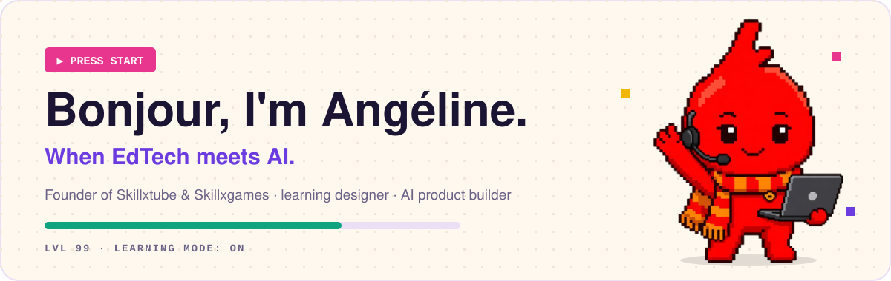
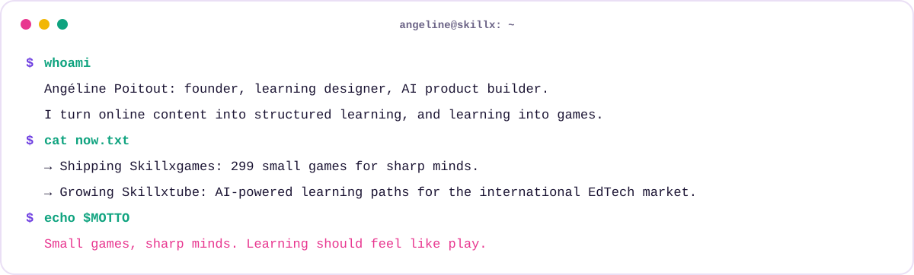
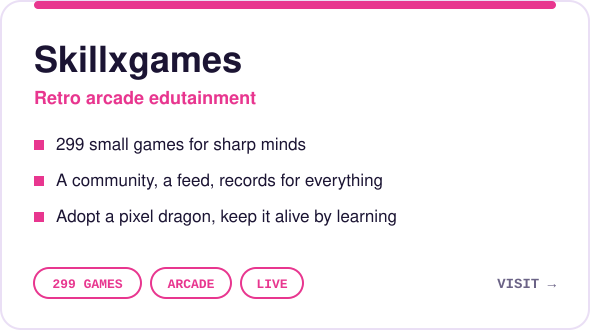
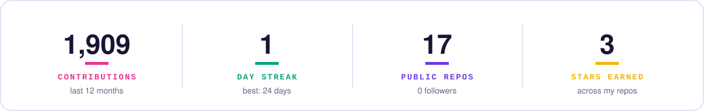
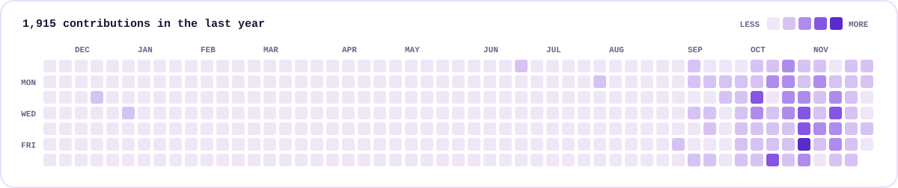
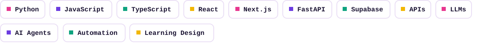

<a href="https://angelinepoitout.com"><picture><source media="(max-width: 600px) and (prefers-color-scheme: dark)" srcset="assets/hero-dark-mobile.svg"><source media="(max-width: 600px)" srcset="assets/hero-light-mobile.svg"><source media="(prefers-color-scheme: dark)" srcset="assets/hero-dark.svg"></picture></a>

<a href="https://angelinepoitout.com"><picture><source media="(prefers-color-scheme: dark)" srcset="assets/badge-website-dark.svg"></picture></a>
<a href="https://linkedin.com/AngelinePoitout"><picture><source media="(prefers-color-scheme: dark)" srcset="assets/badge-linkedin-dark.svg"></picture></a>
<a href="https://skillxtube.com"><picture><source media="(prefers-color-scheme: dark)" srcset="assets/badge-skillxtube-dark.svg"></picture></a>
<a href="https://skillxgames.com/"><picture><source media="(prefers-color-scheme: dark)" srcset="assets/badge-skillxgames-dark.svg"></picture></a>

<picture><source media="(prefers-color-scheme: dark)" srcset="assets/whoami-dark.svg"></picture>

<picture><source media="(prefers-color-scheme: dark)" srcset="assets/section-building-dark.svg"></picture>

<a href="https://skillxgames.com/"><picture><source media="(prefers-color-scheme: dark)" srcset="assets/card-skillxgames-dark.svg"></picture></a>
<a href="https://skillxtube.com"><picture><source media="(prefers-color-scheme: dark)" srcset="assets/card-skillxtube-dark.svg"></picture></a>

<picture><source media="(prefers-color-scheme: dark)" srcset="assets/section-activity-dark.svg"></picture>

<picture><source media="(prefers-color-scheme: dark)" srcset="assets/stats-dark.svg"></picture>

<picture><source media="(prefers-color-scheme: dark)" srcset="assets/activity-dark.svg"></picture>

<picture><source media="(prefers-color-scheme: dark)" srcset="assets/section-background-dark.svg"></picture>

<picture><source media="(prefers-color-scheme: dark)" srcset="assets/background-dark.svg"></picture>

<picture><source media="(prefers-color-scheme: dark)" srcset="assets/section-toolkit-dark.svg"></picture>

<picture><source media="(prefers-color-scheme: dark)" srcset="assets/toolkit-dark.svg"></picture>

Small games for sharp minds · stats redrawn every night by a GitHub Action · <a href="https://angelinepoitout.com">angelinepoitout.com</a>

